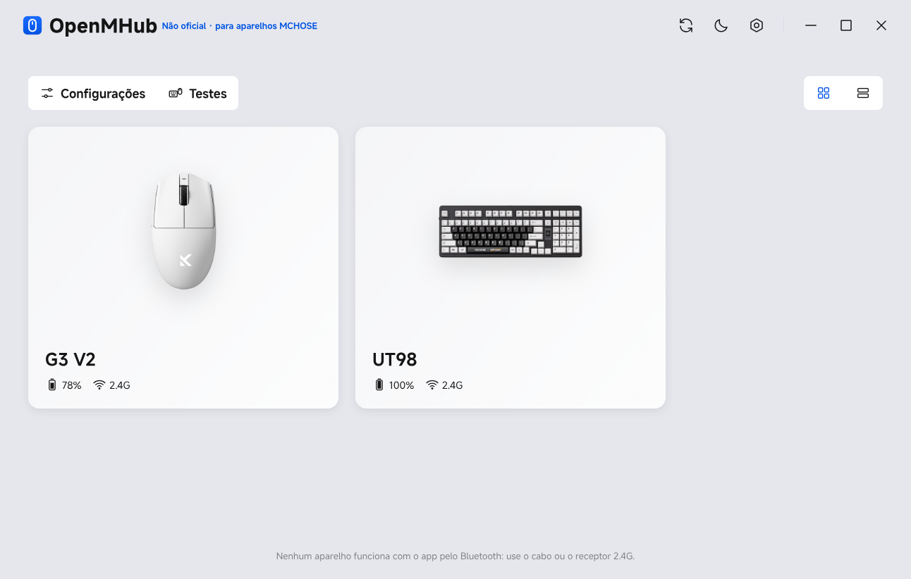
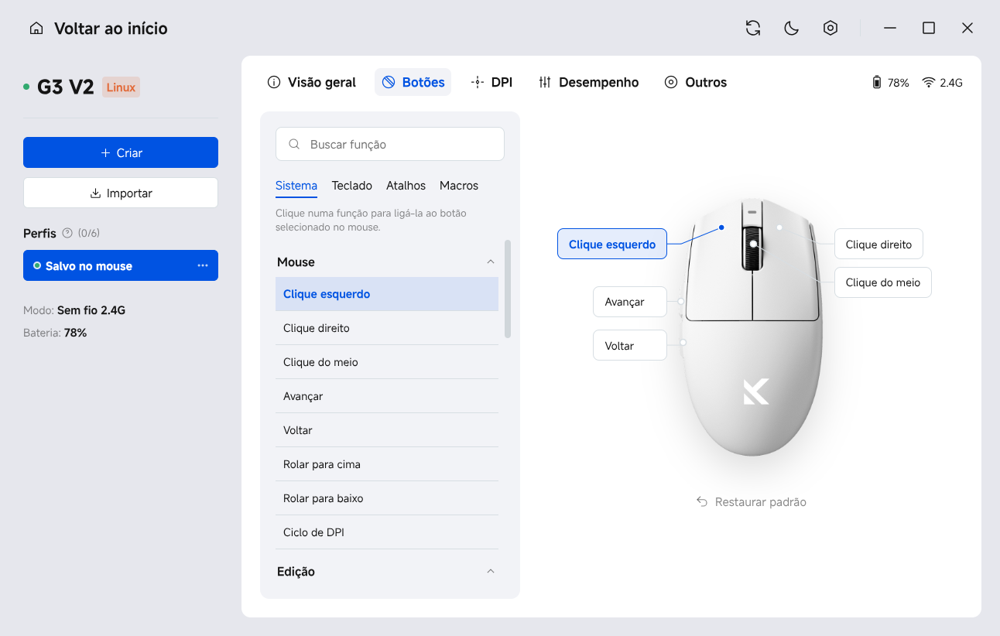
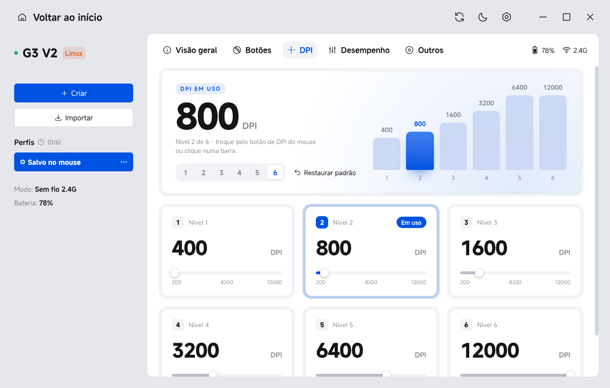
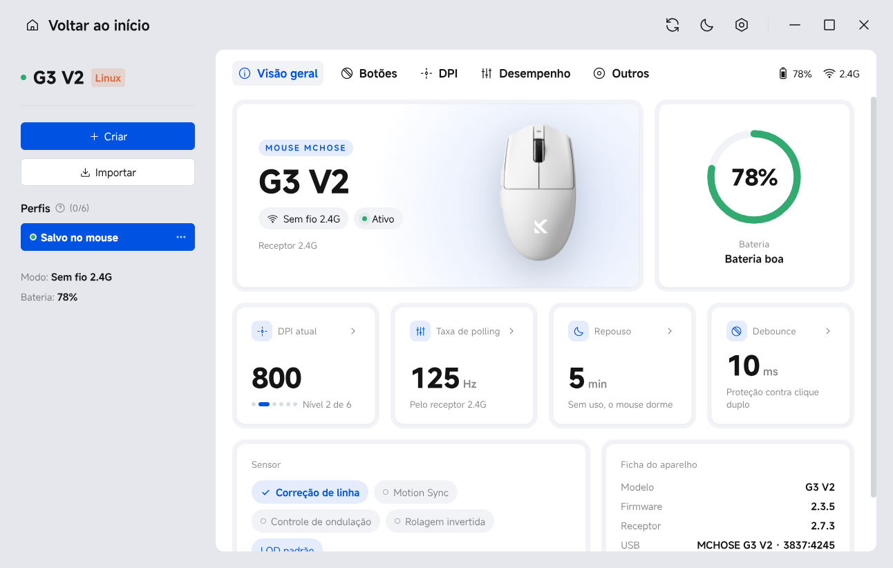
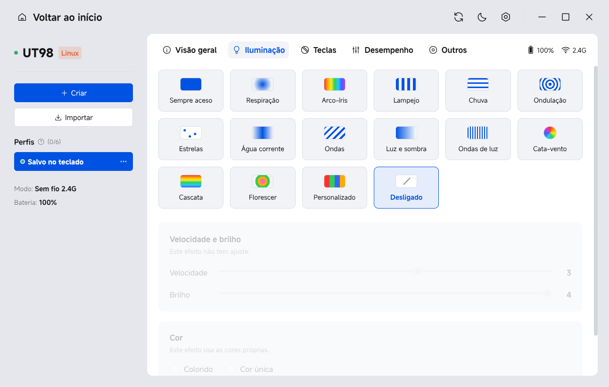

# OpenMHub

[](LICENSE)


[Read in English](README.md)

Um configurador não oficial e de código aberto para mouses e teclados MCHOSE no Linux, feito para ter a aparência e o comportamento do M HUB, o app oficial da MCHOSE, que só roda no Windows. (Antes se chamava "M HUB Linux".)

Veja de relance quanta bateria cada dispositivo tem, se está carregando e se está conectado por cabo ou pelo receptor 2.4G. Nos dispositivos compatíveis, altere as configurações salvas no próprio dispositivo: botões, DPI, polling rate, iluminação, remapeamento de teclas e macros.

> **Não oficial: sem vínculo, patrocínio ou endosso da MCHOSE.** Este é um projeto da comunidade. MCHOSE e M HUB são marcas registradas de seu dono. O app fala com os dispositivos usando os mesmos comandos HID que o driver web oficial do M HUB envia. Atualização de firmware não é suportada de propósito; para isso, use o app oficial.



| Botões do mouse | DPI do mouse |
|---|---|
|  |  |
| **Visão geral do dispositivo** | **Iluminação do teclado** |
|  |  |

## Recursos

**Todo dispositivo MCHOSE que o app reconhece**

- Nível de bateria, estado de carregamento e estado de suspensão ou offline
- Modo de conexão: cabo ou receptor 2.4G. Assim como o M HUB, o app não alcança dispositivos conectados por Bluetooth.
- Versões de firmware do mouse e do receptor
- A foto oficial do produto, com a variante de cor que você escolher no card do dispositivo (86 mouses, teclados e headsets no catálogo). As fotos são baixadas da CDN da MCHOSE na primeira vez em que aparecem e ficam em cache; offline, aparece um ícone genérico.

**Configurações do mouse.** As mudanças são gravadas no mouse assim que você as faz, do mesmo jeito que o M HUB faz:

- **Botões:** remapeie os 5 botões para funções de mouse, teclas de mídia, teclas do teclado, atalhos ou ações de DPI
- **DPI:** de 1 a 6 estágios, o valor de cada estágio e o estágio ativo
- **Desempenho:** polling rate, debounce, LOD, tempo de suspensão, Motion Sync, angle snapping, ripple control e direção da rolagem
- **Macros:** grave ações de teclado e mouse com seus intervalos, escolha um dos 4 modos de repetição e associe a macro a um botão
- **Outros:** restaurar as configurações de fábrica e os passos de pareamento do receptor

**Configurações do teclado**

- Efeitos de iluminação, cores e cor por tecla
- Remapeamento de teclas nas camadas normal, Fn e Fn2
- Macros salvas no teclado (3 modos de repetição)
- Tempo de suspensão, Top Speed, modo Mac, bloqueio da tecla Win e restauração de fábrica
- Backup em JSON de toda a configuração

**Também incluído**

- **Perfis:** até 6 perfis locais por dispositivo, como no M HUB. Crie, renomeie, aplique e exporte ou importe em JSON. A primeira linha é um backup completo do que está salvo no dispositivo.
- **Ferramentas de teste:** teste de teclado (luzes das teclas, rollover, registro de eventos) e teste de mouse (contadores de botões, detector de clique duplo anormal, cliques por segundo, estimativa de polling rate).
- **Bandeja e notificações:** ícone na bandeja com a bateria de cada dispositivo, notificações de bateria fraca e carga completa, mudanças de DPI pelo botão do mouse e Caps/Num/Scroll Lock.
- Temas claro e escuro, visualização dos dispositivos em grade e em lista, e as animações de tela, aba e card do M HUB.

O app e o instalador estão em inglês, português do Brasil, espanhol e francês. Eles seguem o idioma do sistema e usam inglês para qualquer outro idioma. Para escolher outro, vá em Configurações > Geral > Idioma. Traduções são bem-vindas. Um novo idioma precisa de um dicionário em `app/renderer/i18n/` (registrado em `app/renderer/i18n.js`), dos textos da bandeja em `app/main.js` e dos textos do instalador em `install.sh` e `packaging/installer.py`; `node tools/check-i18n.mjs` confere se falta alguma chave.

## Dispositivos compatíveis

| Dispositivo | ID USB | O que funciona |
|---|---|---|
| MCHOSE G3 V2 pelo cabo | 3837:418c | Bateria, firmware e todas as configurações do mouse. Com a chave do mouse em 2.4G, o cabo só carrega e esta interface fica em silêncio. |
| Receptor 2.4G do MCHOSE G3 V2 | 3837:4245 | Bateria, carregamento, estado online, firmware e todas as configurações do mouse |
| Teclado MCHOSE UT98 / G98 V2 pelo dongle 2.4G (Sinowealth) | 41e4:2004 | Bateria, carregamento, estado de suspensão e todas as configurações do teclado |
| Teclado MCHOSE UT98 / G98 V2 pelo cabo | 41e4:2203 | Bateria e todas as configurações do teclado, com o mesmo protocolo do dongle 2.4G |
| Headsets MCHOSE V9, V9 PRO, G9 PRO e S9 PRO pelo dongle 2.4G | 41e4:3201, 41e4:3202, 41e4:3502, 41e4:3402, 291d:385d | Bateria, carregamento, firmware e o preset de EQ. **Não testado**: escrito a partir do código do M HUB |
| Headset MCHOSE X9 | 3837:6045 | Igual ao anterior. **Não testado** |
| Headsets MCHOSE V9 TURBO e V9 TURBO+ | 3837:600d, 3837:600a, 3837:6009 | Igual ao anterior, mais desligamento automático, volume do tom de aviso e restauração de fábrica. **Não testado** |

Nos headsets, os controles do equalizador, surround, redução de ruído e configurações de microfone que o M HUB mostra rodam no driver de áudio dele no Windows, não no headset, então o OpenMHub não consegue oferecê-los. Use as configurações de som do seu desktop ou um equalizador como o EasyEffects. Se você tem um desses headsets, abra uma issue contando o que funciona.

Outros dispositivos MCHOSE aparecem com a foto, mas sem bateria nem configurações, até alguém adicionar um driver para o protocolo deles. Veja [Adicionar um dispositivo](#adicionar-um-dispositivo).

## Instalação

### Instalação rápida (qualquer distribuição)

Rode isto em um terminal. O comando baixa o instalador da versão mais recente e instala sem fazer mais perguntas:

```sh
curl -fLo /tmp/OpenMHub-Installer.run https://github.com/brayanspagnol/OpenMHub/releases/latest/download/OpenMHub-Installer.run && sh /tmp/OpenMHub-Installer.run --yes
```

Ele pede sua senha uma ou duas vezes (veja [o que o instalador faz](#instalador-qualquer-distribuição)). Funciona em distribuições baseadas em glibc (Arch, Debian, Ubuntu, Fedora, openSUSE…) em x86-64 e ARM (64 e 32 bits). Alpine e outras distribuições baseadas em musl não são suportadas.

### Instalador (qualquer distribuição)

Baixe `OpenMHub-Installer.run` da [versão mais recente](../../releases/latest) e dê dois cliques nele, ou rode `sh OpenMHub-Installer.run` em um terminal. Uma janelinha abre:

1. Clique em "Instalar". Se quiser, marque "Iniciar com o sistema" para o app abrir escondido na bandeja quando você entrar na sessão.
2. Quando terminar, clique em "Abrir OpenMHub" ou abra "OpenMHub" no menu de aplicativos.

Alguns gerenciadores de arquivos só executam o arquivo depois que você o marca como executável (`chmod +x OpenMHub-Installer.run`). O nome do arquivo é o mesmo em toda versão, então `https://github.com/brayanspagnol/OpenMHub/releases/latest/download/OpenMHub-Installer.run` sempre aponta para a mais nova.

**O que o instalador faz**

- **Electron:** o app roda no Electron 42.
  - Se o `electron42` já estiver instalado, ele usa esse.
  - No Arch, instala o `electron42` com o pacman, pedindo sua senha em uma janelinha.
  - Nas outras distribuições, baixa o build oficial do Electron (cerca de 110 MB) das releases do Electron no GitHub para `~/.local/share/mhub-linux/electron` e confere o checksum SHA-256. Depois pede sua senha para configurar o helper de sandbox do Electron (`chrome-sandbox`), necessário no Ubuntu 24.04 e mais novos.
- **Regra udev:** instala uma regra em `/etc/udev/rules.d` para o app falar com os dispositivos sem root. Esse passo também pede sua senha e é pulado se a regra já existir.
- **Sua pasta pessoal:** todo o resto vai para cá:
  - o app em `~/.local/share/mhub-linux`
  - o lançador `mhub-linux` em `~/.local/bin`
  - os ícones e a entrada no menu
- **Sem sessão gráfica:** o mesmo instalador faz as perguntas no terminal (`--terminal`), e `--yes` instala sem perguntar.

**Atualizar e desinstalar**

- Para atualizar, rode um instalador mais novo.
- Para desinstalar, rode o instalador de novo e clique em "Desinstalar", ou rode `~/.local/share/mhub-linux/uninstall.sh`. Acrescente `--all` para remover também a regra udev e suas preferências.

### Pacotes para Debian, Ubuntu, Fedora e openSUSE

Cada versão tem pacotes `.deb` e `.rpm` para x86-64 (`amd64` / `x86_64`) e ARM64 (`arm64` / `aarch64`). Eles já incluem o Electron, então não é preciso baixar mais nada. Baixe o do seu sistema na [versão mais recente](../../releases/latest) e instale:

```sh
sudo apt install ./openmhub_*_amd64.deb        # Debian, Ubuntu, Linux Mint, Pop!_OS
sudo dnf install ./openmhub-*.x86_64.rpm        # Fedora
sudo zypper install ./openmhub-*.x86_64.rpm     # openSUSE
```

Eles colocam o app em `/usr/lib/mhub-linux`, o lançador em `/usr/bin/mhub-linux` e a regra udev em `/usr/lib/udev/rules.d`. Seu gerenciador de pacotes cuida das atualizações e da remoção (`sudo apt remove openmhub`, `sudo dnf remove openmhub`).

### Arch Linux

O OpenMHub está no AUR como [`openmhub`](https://aur.archlinux.org/packages/openmhub). Instale com um helper do AUR, por exemplo `yay -S openmhub`, ou manualmente:

```sh
git clone https://aur.archlinux.org/openmhub.git && cd openmhub && makepkg -si
```

Ele usa o pacote `electron42` dos repositórios do Arch.

## Executando

Abra "OpenMHub" no menu de aplicativos ou rode `mhub-linux`.

- F12 abre o DevTools.
- A página de Configurações tem um modo de depuração que mostra as respostas HID brutas.

## Integração com o desktop

- **Uma cópia por vez:** abrir o app de novo traz a janela existente para a frente.
- **Ícone na bandeja:** lista cada dispositivo com bateria, estado de carregamento e modo de conexão.
  - Clicar nele abre a janela. O menu tem "Abrir OpenMHub" e "Sair".
  - Ele precisa de um host StatusNotifierItem, como o módulo `tray` do waybar ou uma extensão de bandeja do KDE/GNOME.
- **Fechar a janela:** esconde na bandeja, e o monitoramento de bateria continua. Use "Sair" no menu da bandeja. Sem bandeja, fechar a janela encerra o app.
- **Notificação de bateria fraca:**
  - Avisa quando um dispositivo que não está carregando cai até o limite (20% por padrão).
  - Dispara uma vez por descarga e reinicia quando o dispositivo carrega ou volta a ficar acima do limite.
  - Uma notificação opcional avisa quando a carga chega a 100%.
- **Iniciar com o sistema:** grava `~/.config/autostart/mhub-linux.desktop`, que abre o app escondido na bandeja (`mhub-linux --hidden`).
  - Desktops que seguem a especificação de autostart XDG reconhecem esse arquivo.
  - O Hyprland ignora essa pasta, então o app também adiciona uma linha marcada com `mhub-linux-autostart` em `~/.config/hypr/hyprland.lua` (ou `hyprland.conf`). A linha é removida quando você desliga a opção. A primeira edição salva um backup ao lado do arquivo, com o sufixo `.mhub-bak`.
  - Outros compositores precisam de `exec-once = mhub-linux --hidden`, ou equivalente, na configuração deles.
- **Preferências:** salvas em `~/.config/mhub-linux/prefs.json`. As fotos de produto baixadas ficam em cache em `device-images/`, na mesma pasta.
- **Classe da janela:** o app id no Wayland é `mhub-linux`, igual à entrada de desktop.

## Desenvolvimento

O app é JavaScript puro sobre Electron: sem etapa de build e sem dependências npm. Você só precisa do `electron42`.

```sh
git clone https://github.com/brayanspagnol/OpenMHub.git
cd OpenMHub
sudo cp udev/70-mhub-linux.rules /etc/udev/rules.d/ && sudo udevadm control --reload && sudo udevadm trigger
./mhub-linux            # roda a partir do checkout, nada é instalado
```

- **Instalar a partir do checkout:** `./install.sh` instala com a mesma estrutura do instalador. `--gui` abre a janela do instalador e `--help` lista as opções. `./uninstall.sh` remove.
- **Gerar os arquivos de release:** `packaging/build-installer.sh` gera `dist/OpenMHub-Installer.run`; os pacotes `.deb` e `.rpm` quando o [nfpm](https://nfpm.goreleaser.com) está instalado (a partir de `packaging/nfpm.yaml`, baixando o Electron); e o pacote do Arch a partir de `packaging/PKGBUILD` quando o `makepkg` está disponível.
- **Só uma instância roda por vez.** Se o app instalado estiver aberto, `./mhub-linux` só o traz para a frente: feche-o pela bandeja antes.

### Estrutura do projeto

| Caminho | O que é |
|---|---|
| `app/main.js` | Processo principal do Electron: janela sem moldura, permissões WebHID, bandeja, notificações, preferências e o protocolo `mhub-img://`, que baixa e guarda em cache as fotos dos produtos |
| `app/preload.js` | A ponte `window.mhub` entre a interface e o processo principal |
| `app/renderer/app.js` | Telas (início, página do dispositivo, configurações) e polling dos dispositivos |
| `app/renderer/drivers/` | Um driver por protocolo: `g3v2.js` (mouse G3 V2), `sinowealth.js` (teclado UT98 / G98 V2), `headset.js` (headsets sem fio C-Media), `base.js` (código HID compartilhado de requisição/resposta) |
| `app/renderer/views/` | Abas do dispositivo: `mouse.js`, `keyboard.js`, `headset.js`, `macros.js`, `profiles.js`, `tester.js` |
| `app/renderer/data/` | Tabelas tiradas do M HUB: funções dos botões do mouse, layout de teclas do UT98 e o catálogo de dispositivos |
| `app/renderer/device-images.js` | Encontra a foto e as cores de um dispositivo em `data/device-catalog.js` |
| `app/renderer/assets/devices/generic/` | Ícones genéricos de mouse, teclado e receptor, mostrados quando um dispositivo não tem foto ou a foto não pode ser baixada |
| `tools/fetch-device-assets.py` | Reconstrói o catálogo de dispositivos (com a URL de cada foto na CDN) a partir do app web e da configuração remota do M HUB: `uv run --with pillow tools/fetch-device-assets.py`. Rode de novo quando a MCHOSE lançar produtos novos. |
| `udev/`, `install.sh`, `uninstall.sh`, `packaging/` | Regra udev, scripts de instalação, instalador GTK, entrada de desktop, PKGBUILD, pacote do AUR (`packaging/aur/`), `nfpm.yaml` para .deb/.rpm e `build-installer.sh` |

### Adicionar um dispositivo

1. **Dê acesso ao dispositivo:**
   - adicione o vendor ID e o product ID USB em `udev/70-mhub-linux.rules`;
   - adicione os mesmos IDs à lista `VENDORS` em `app/main.js`.
2. **Escreva o driver:** adicione um driver em `app/renderer/drivers/` que estenda `HidDriver` de `base.js`.
   - `match(vendorId, productId)` reivindica o dispositivo.
   - `poll()` retorna `{ online, battery, charging, mode }`. Só isso já dá ao dispositivo o card, a bateria e a entrada na bandeja.
3. **Registre o driver:** adicione-o em `app/renderer/drivers/index.js`.
4. **Configurações:** adicione depois que o status estiver funcionando.

O M HUB agrupa os dispositivos MCHOSE em poucas famílias de protocolo. Cada família precisa de um driver, não um por modelo:

- **Mouses:** FRK (G3, G3 V2, G7, A7e), RY (M7, L7, A7, K7) e NDK (A5 V3, A7 V3, K7 V2, G3 V3).
- **Teclados:** BY, as placas Sinowealth (K99, G98, G87, X75, UT98…), e CZ, as placas magnéticas Ace, Jet e Mix.

Os drivers daqui cobrem um modelo de FRK e um de BY. Teste em hardware real e abra uma issue ou pull request contando o que funciona.

## Versionamento e releases

O projeto segue o [Versionamento Semântico](https://semver.org/lang/pt-BR/). A versão fica em um só lugar, `app/package.json`; o PKGBUILD, o instalador e o app leem dali. As mudanças estão listadas no [CHANGELOG.md](CHANGELOG.md).

Para fazer uma release:

1. Defina a nova versão em `app/package.json`.
2. Mova as entradas de `Unreleased` em `CHANGELOG.md` para a nova versão e data.
3. Faça o commit e a tag: `git tag -a v0.2.0 -m "v0.2.0"` e `git push --follow-tags`.
4. Rode `packaging/build-installer.sh` e anexe `dist/OpenMHub-Installer.run` e os pacotes `.deb` e `.rpm` à release da tag no GitHub.
5. Atualize o pacote do AUR: defina `pkgver` e o `sha256sums` do tarball de código da tag em `packaging/aur/PKGBUILD`, gere de novo o `.SRCINFO` com `makepkg --printsrcinfo > .SRCINFO`, faça o commit e envie os dois arquivos para `ssh://aur@aur.archlinux.org/openmhub.git`.

## Como este projeto foi feito

A maior parte do código, do empacotamento e da documentação deste repositório foi escrita com a ajuda de um assistente de programação com IA (Claude), dirigido e testado pelo mantenedor em hardware real. Os protocolos dos dispositivos vêm do estudo do configurador web da própria MCHOSE. Avise se algo parecer errado.

## Licença

O código-fonte é distribuído sob a [licença MIT](LICENSE).

Estes arquivos não são cobertos por essa licença e pertencem a seus donos:

- **Fotos dos produtos**: © MCHOSE. Elas não vêm junto com o app: ele as baixa da CDN pública da MCHOSE em tempo de execução e as guarda em cache localmente, para os dispositivos aparecerem como no M HUB. Os ícones genéricos em `app/renderer/assets/devices/generic/` também vêm do M HUB.
- **Fontes MiSans** em `app/renderer/assets/fonts/`: © Xiaomi, distribuídas sob a licença de fontes MiSans.

Se você é detentor de direitos e quer que algum deles seja removido, abra uma issue.
